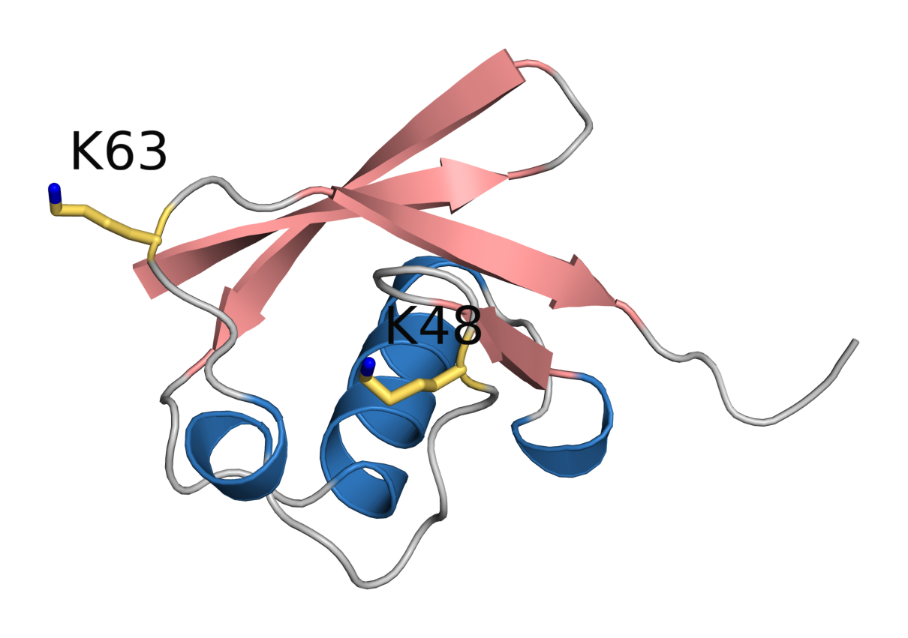
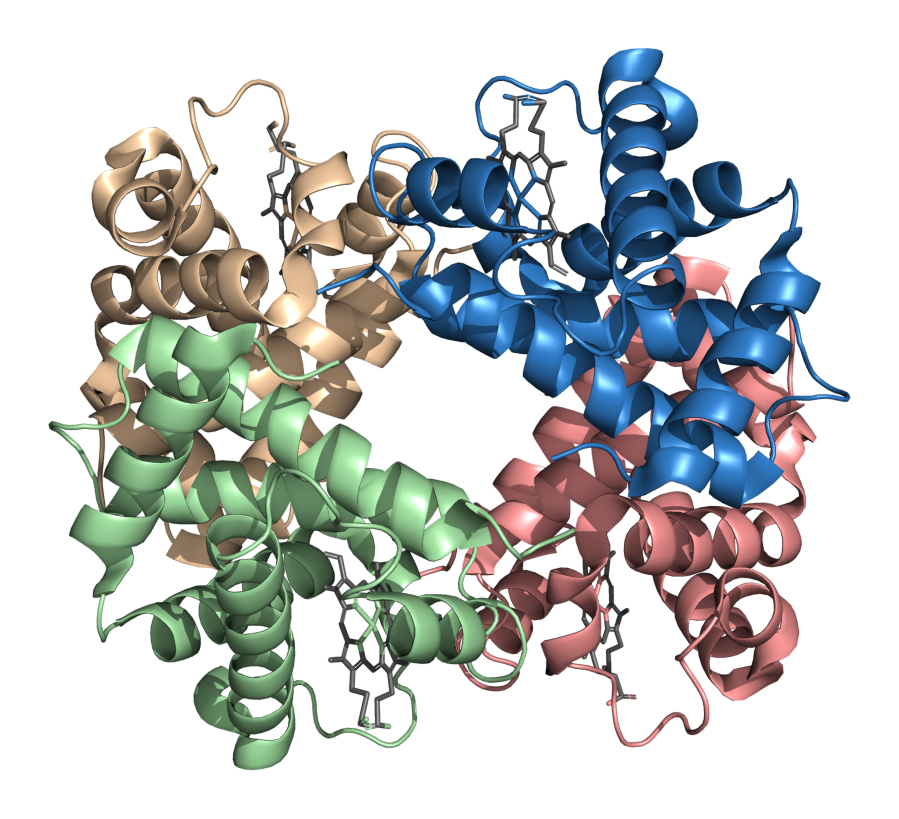
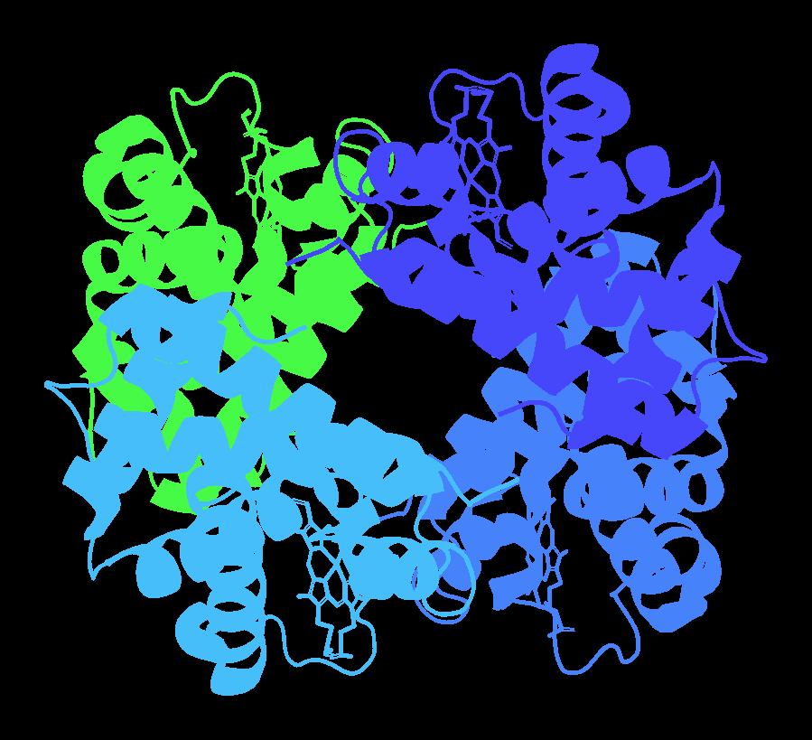
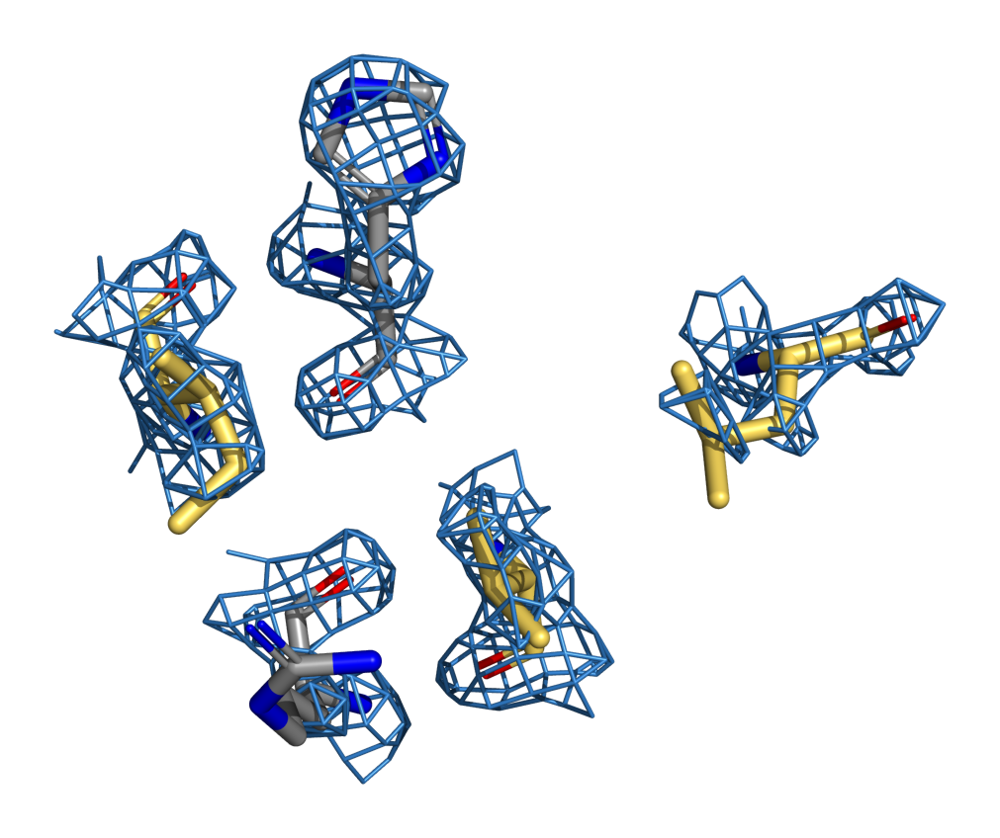
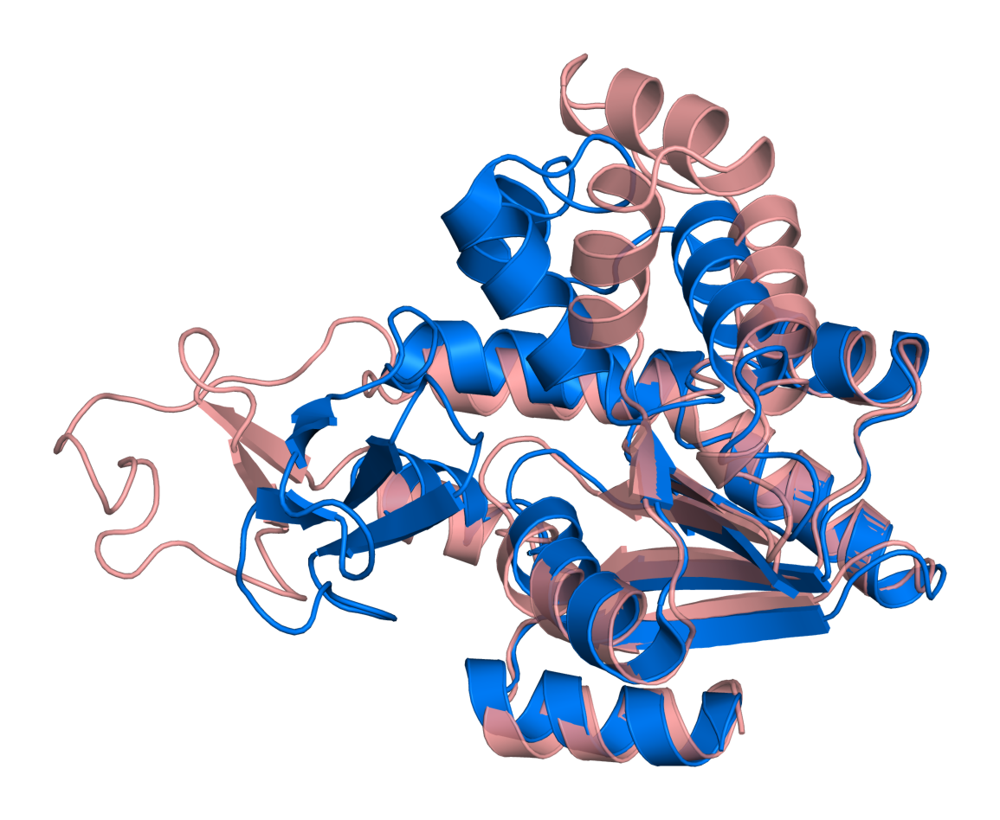
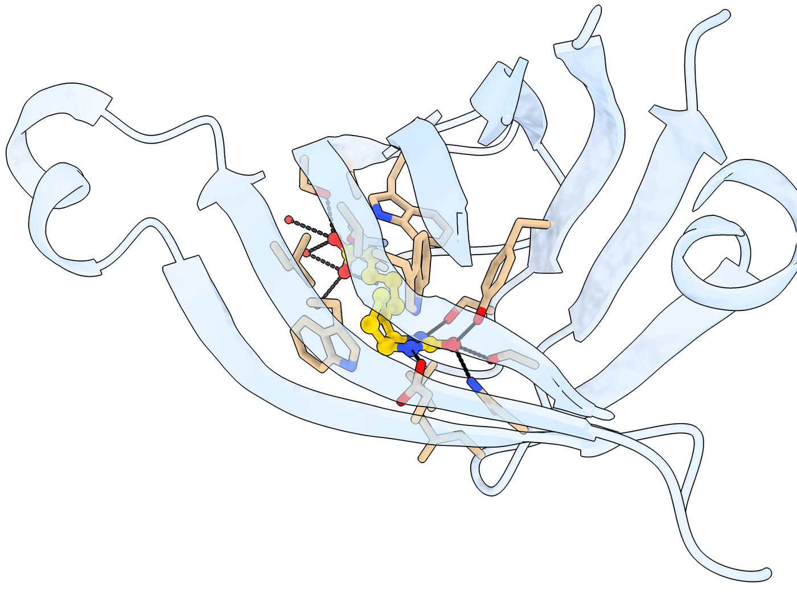
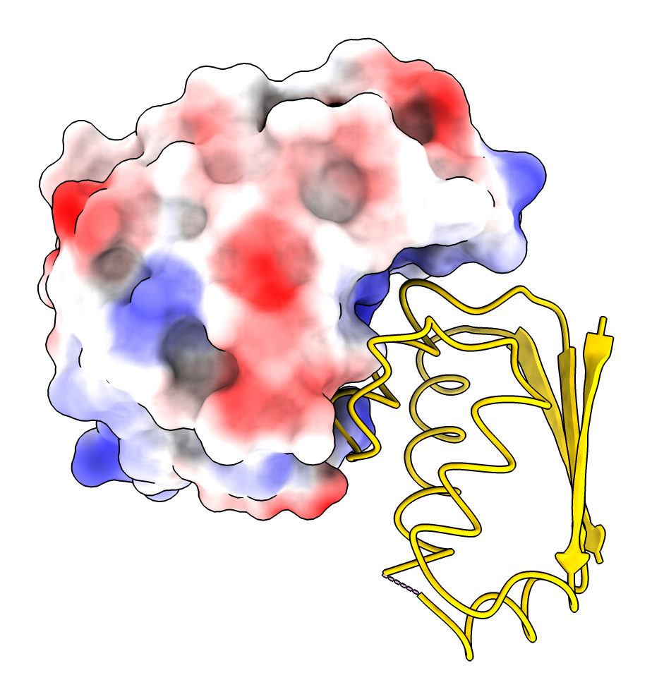
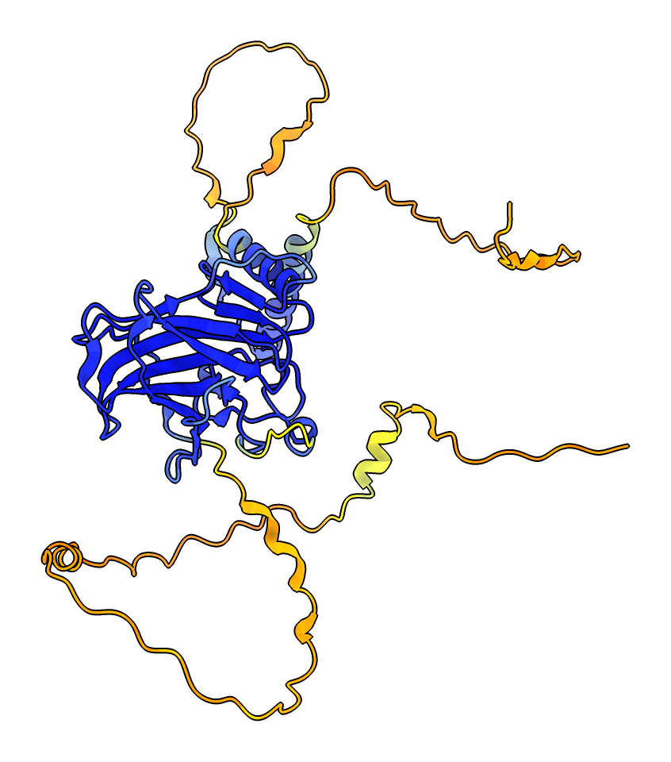
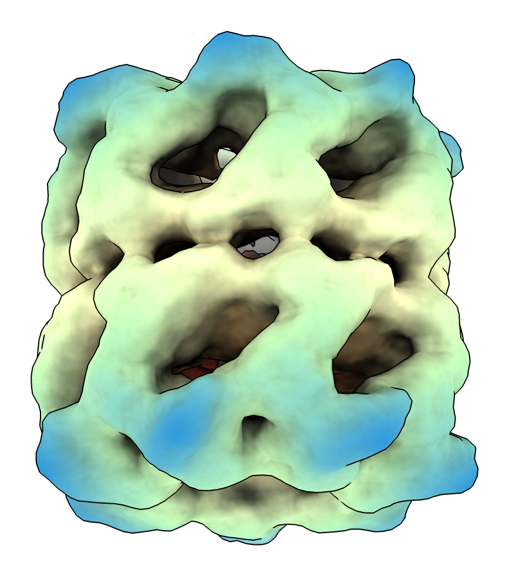

<div align="center">

# molmcp

**Let Claude Code, Codex and any MCP client drive PyMOL and ChimeraX, and know what the picture shows.**

Two MCP servers with a bridge inside each viewer: fast commands, a live view of the scene, and render analysis that
tells the agent what is on screen without a vision model. Plus a Claude Code style chat panel inside both programs.

[](https://github.com/Jetzu/Structural-Biology-MCPs/actions/workflows/ci.yml)


</div>

```text
> Make a publication figure of ubiquitin (1UBQ): cartoon coloured by secondary structure, Lys48 and Lys63
  as labelled sticks, white background.
```

<p align="center"></p>

<details>
<summary>What the agent reads instead of looking at the picture</summary>

```text
Content covers 8% of the 1600x1200 frame (bounding box 68% x 60%). Centroid is centred. Free margins: left 21%,
right 12%, top 18%, bottom 22%. Dominant colours: salmon 34%, steelblue 22%, darkgrey 11%, grey 7%.
Background white; foreground/background contrast 4.1:1.
clipped_edges: []

                           .:.
                         -#%+.-.
           ::.:        -#*-   .-
          :....::: .:-#%*#%=::.
          ----=.:++##==*@#*-.
             =%#=-%+   =+**#%%#=
              .:=@=    ##**#-:--::
               :+.    *#@@*=%%:.  :::    -.
              -:=+-. =%@@+--.= .-   .::::
              -+*.==:#-+=-  :=+*:
              .:-**-:*%%.-    ..
                   .::  -.
                     .::
```
</details>

Every figure in this README was made through the MCP servers: an agent's `run` commands followed by `render` or
`layout`. [examples/make_gallery.py](examples/make_gallery.py) replays them, and the full replies the agent got are
in [docs/images/analysis](docs/images/analysis). PyMOL figures were rendered with open-source PyMOL 3.1, ChimeraX
figures with ChimeraX 1.11.

## Gallery

### Seeing without vision

> *"Show haemoglobin (4HHB) with each chain in its own colour and the hemes as sticks, then tell me how much of
> each chain is visible and which chains hide each other."*

`layout` renders an ID pass in which every chain gets a flat colour, measures it, and restores the scene. With
`occlusion=True` it also renders each chain alone to see how much of it is hidden.

<p align="center">


</p>

| chain | share of the molecule on screen | hidden behind other chains |
|---|---|---|
| 4hhb/A | 30% | 0% |
| 4hhb/C | 30% | 0% |
| 4hhb/B | 20% | 26% |
| 4hhb/D | 20% | 26% |

On screen, chain C borders D and A borders B (about 1,700-1,800 boundary pixels each), and B borders C and A
borders D (about 700).

### Electron density

> *"Show the 2mFo-DFc density of ubiquitin at 1.5 sigma around the Ile44 hydrophobic patch (Leu8, Ile44, Val70)
> as a carved mesh."*

<p align="center"></p>

### Superposition

> *"Superpose closed (1AKE) and open (4AKE) adenylate kinase, colour them differently and give me the RMSD."*

`align` returns the numbers: RMSD 7.19 Å over 1,656 atoms before refinement, 2.07 Å over 1,135 atoms after five
cycles, 214 residues aligned. The lid and AMP-binding domains swing open; the core superposes.

<p align="center"></p>

### Ligand sites

> *"Zoom into the biotin pocket of streptavidin (1STP): biotin as ball-and-stick, the pocket residues as sticks,
> hydrogen bonds as dashed lines."*

<p align="center"></p>

The render description for this one warns that the pale cartoon has a 1.5:1 contrast against the white
background, and that the cartoon is cut off at the right edge. Those are the kinds of facts the agent uses to
adjust a figure without seeing it.

### Electrostatics

> *"Colour barnase by Coulombic potential and show its inhibitor barstar as a cartoon next to it (1BRS)."*

<p align="center"></p>

### AlphaFold confidence

> *"Fetch the AlphaFold model of human p53 and colour it by pLDDT confidence."*

<p align="center"></p>

### Cryo-EM maps

> *"Open the GroEL cryo-EM map EMD-1080 as a surface coloured radially from its centre, side view."*

<p align="center"></p>

More prompts to copy: [examples/prompts.md](examples/prompts.md), with the tools each one uses.

## What it can do

| | |
|---|---|
| **Run** | any PyMOL or ChimeraX command, in batches, with per-command output and errors and a list of what changed; Python inside either program |
| **Know** | structured scene snapshots (objects, chains, representations, colours, selections, camera, settings) and an event stream of what you do in the GUI |
| **Look** | render analysis without a vision model: coverage, framing, clipped edges, named colours, contrast, ASCII map; ID passes per object or chain with screen share, contacts and occlusion; diffs between renders |
| **Analyse** | distances, angles, RMSD, SASA, superposition with residue pairs, sequences, contacts, per-residue tables (secondary structure, B-factor or pLDDT, colours), point mutations, density levels |
| **Skills** | 43 reviewed recipes the agent reads on demand (publication figures, surfaces, maps, ligands, AlphaFold, movies, ...); add your own |
| **Windows** | several PyMOL and ChimeraX windows at once, each its own session; the server follows the one you work in |
| **Headless** | PyMOL as a library without a window (Linux, CI); ChimeraX `--nogui --offscreen` on Linux |

Commands go over a persistent localhost connection to a bridge inside the viewer, about 0.2 ms per call, instead of
starting a new process for each command.

## Install

```bash
git clone git@github.com:Jetzu/Structural-Biology-MCPs.git mol-mcp && cd mol-mcp
python3 install.py
```

This creates a virtual environment and sets up whatever it finds: the bridge in PyMOL and/or ChimeraX, registered
with Claude Code, Codex and/or Claude Desktop. Anything not installed is skipped; run it again after installing it.
Check with `python3 install.py --check`; run `/mcp` in Claude Code or `codex mcp list` to see the servers.

Optional flags, which combine freely: `--pymol` / `--chimerax` for one viewer only, `--claude` / `--codex` /
`--claude-desktop` for one client only (e.g. `--pymol --codex`), `--no-<name>` to skip something that is installed,
`--uninstall`, `--dry-run`.

Requirements: Python 3.10+, and PyMOL (incentive or open-source) and/or UCSF ChimeraX. Restart the viewers after
installing so the bridge starts. Step-by-step instructions for macOS, Linux and Windows are in
[docs/SETUP.md](docs/SETUP.md).

## Agent Chat inside PyMOL and ChimeraX

A chat panel in each viewer that runs your Claude Code or Codex CLI on that very window: the **Agent** button next
to *Builder...* in PyMOL, the **Agent** tab in ChimeraX's toolbar, or `claude <text>` / `codex <text>` on either
command line. It streams the agent's text and tool calls in Claude Code's style, and `/model` switches provider,
model and effort. See [docs/agent-chat.md](docs/agent-chat.md).

## Documentation

| | |
|---|---|
| [docs/SETUP.md](docs/SETUP.md) | installation on macOS, Linux and Windows, Claude-only and Codex-only setups, troubleshooting, uninstalling |
| [docs/detailed.md](docs/detailed.md) | full tool table, environment variables, how it works, PyMOL quirks, what has been verified where, development |
| [docs/agent-chat.md](docs/agent-chat.md) | the in-app chat panel |
| [docs/FEATURE_COVERAGE.md](docs/FEATURE_COVERAGE.md) | which PyMOL and ChimeraX features are reachable how, and the QA rounds |
| [examples/](examples) | prompts to copy, and `make_gallery.py`, which regenerates the images above |

Tested on macOS and Linux with both viewers, and on Windows for PyMOL (with and without a window) and the ChimeraX
server. ChimeraX itself has not been run on Windows yet, because its installer needs a licence click-through that
CI cannot do.

PyMOL is a trademark of Schrödinger, LLC. UCSF ChimeraX is developed by the Resource for Biocomputing,
Visualization, and Informatics at UCSF. This project is not affiliated with either.
